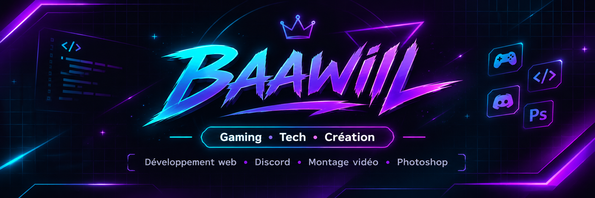

  

  
  

---

## 👋 Salut, moi c'est Baawiil !

Passionné par le **gaming, la technologie et la création numérique**, j'aime concevoir de nouvelles expériences, explorer différents outils et donner vie à mes idées.

Mes centres d'intérêt vont du développement web aux projets Discord, en passant par le montage vidéo, la retouche photo et les jeux vidéo.

- 🎮 **Gaming :** FPS, simulation, gestion et coopération
- 💻 **Développement :** HTML, CSS, JavaScript, Tailwind CSS
- 🤖 **Discord :** communautés, bots et automatisations
- 🎬 **Audiovisuel :** montage vidéo avec Premiere Pro
- 🎨 **Création graphique :** retouche photo avec Photoshop
- 🌍 **Localisation :** France

---

## 🌐 Mes réseaux

  
  

---

## 🛠️ Langages, outils & technologies

### Développement web

  

### Environnements & plateformes

  

### Création audiovisuelle

  

---

<h2>🚀 Projets & réalisations</h2>

<table>
  <tr>
    <td width="50%" valign="top">
      <h3>💜 PULSE / ÉKO</h3>
      
<strong>DISCORD • COMMUNAUTÉ</strong>

      

        Communauté Discord immersive avec progression,
        personnalisation et mascotte virtuelle interactive.
      

      
🟡 <strong>En conception</strong>

    </td>
    <td width="50%" valign="top">
      <h3>🌐 OrbitGG</h3>
      
<strong>WEB • DISCORD</strong>

      

        Plateforme de référencement et de découverte
        de bots et de serveurs Discord.
      

      
🟡 <strong>En conception</strong>

    </td>
  </tr>
  <tr>
    <td width="50%" valign="top">
      <h3>🎮 DISASTER SERVICE</h3>
      
<strong>GAMING • SIMULATION 3D</strong>

      

        Concept de jeu de simulation solo et coopératif,
        avec des parties pouvant réunir jusqu'à 8 joueurs.
      

      
🟣 <strong>Concept</strong>

    </td>
    <td width="50%" valign="top">
      <h3>💻 Portfolio Baawiil</h3>
      
<strong>HTML • JAVASCRIPT • TAILWIND CSS</strong>

      

        Mon portfolio personnel dédié au gaming,
        à la technologie et à la création numérique.
      

      
🟢 <strong>En ligne</strong>

      <a href="https://baawiil.github.io/">
        🌐 Visiter le portfolio
      </a>
    </td>
  </tr>
</table>

---

## 🎓 Certifications & formations

### ✅ Monteur vidéo LPA

**Statut :** Certification obtenue  
**Organisme :** La Porte Académie (LPA)  
**Domaine :** Montage vidéo

🎬 [Découvrir la formation officielle](https://laporteacademie.com/formations/formation-montage-video-2/)

### ⏳ Formation Retouche Photo (Photoshop)

**Statut :** En cours de certification  
**Organisme :** La Porte Académie (LPA)  
**Domaine :** Retouche et création graphique

🎨 [Découvrir la formation officielle](https://laporteacademie.com/formations/formation-retouche-photo-photoshop/)

---

<h2>⚡ Mon univers technique</h2>

  

  <strong>Développement Web • Discord • Création numérique</strong>

  
  

  <a href="https://baawiil.github.io/">🌐 Portfolio</a> •
  <a href="https://github.com/baawiil">💻 GitHub</a>

